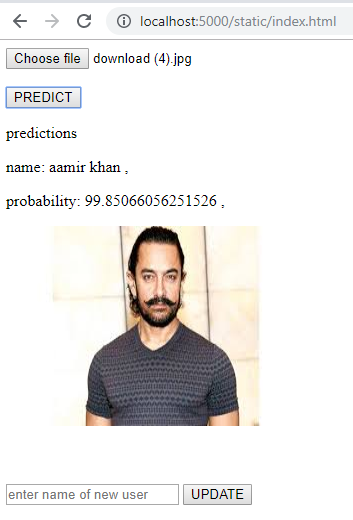

# Face Identification and Recognition using OpenFace  

This project leverages **dlib**, **OpenFace**, and **Keras** to perform face identification and recognition. The model extracts numerical embeddings from faces and classifies them using a deep learning model. It is deployed using **Flask** for real-time predictions.  

## Features  
- **Face Identification** using the **dlib** library  
- **Face Embeddings** generated using the **OpenFace** model  
- **Deep Learning-based Face Recognition** using a **Keras Sequential Model**  
- **Web Deployment** using **Flask**  

## Deployment Preview  
After deploying the Flask application, the interface looks as follows:  

  

## Requirements

Install the dependencies with:

```sh
pip install -r requirements.txt
```

Main libraries: Flask, Keras/TensorFlow, dlib, OpenCV, NumPy, pandas, scikit-learn and Pillow.
The code uses the standalone Keras 2.x API, so use a Keras/TensorFlow version from that era.

## Project Structure

| File | Purpose |
| --- | --- |
| `app.py` | Flask server: receives an uploaded image and returns the predicted identity |
| `Align.py` | Face detection and alignment with dlib landmarks |
| `model.py`, `utils.py` | OpenFace network definition, adapted from [Keras-OpenFace](https://github.com/iwantooxxoox/Keras-OpenFace) |
| `open_face.h5` | Pretrained OpenFace weights used to produce 128-d face embeddings |
| `saved/` | Trained classifier, label encoder and reference embeddings |
| `training_and_predict.ipynb` | Embedding extraction, classifier training and evaluation |
| `static/index.html` | Upload-and-predict web page |

## How to Use  

Follow these steps to run the project:  

1. **Install the requirements** (see above)  
2. **Clone the Repository**  
3. **Run the Flask Server**
    Open a terminal or command prompt in the project directory and execute:
    ```sh
    flask run --host=0.0.0.0
    ```
4. **Open the Application in a Browser**
    - Navigate to the provided localhost URL
    - Upload an image and predict!


This project demonstrates an end-to-end pipeline for face recognition, making it useful for security systems, biometric authentication, and other AI applications.
